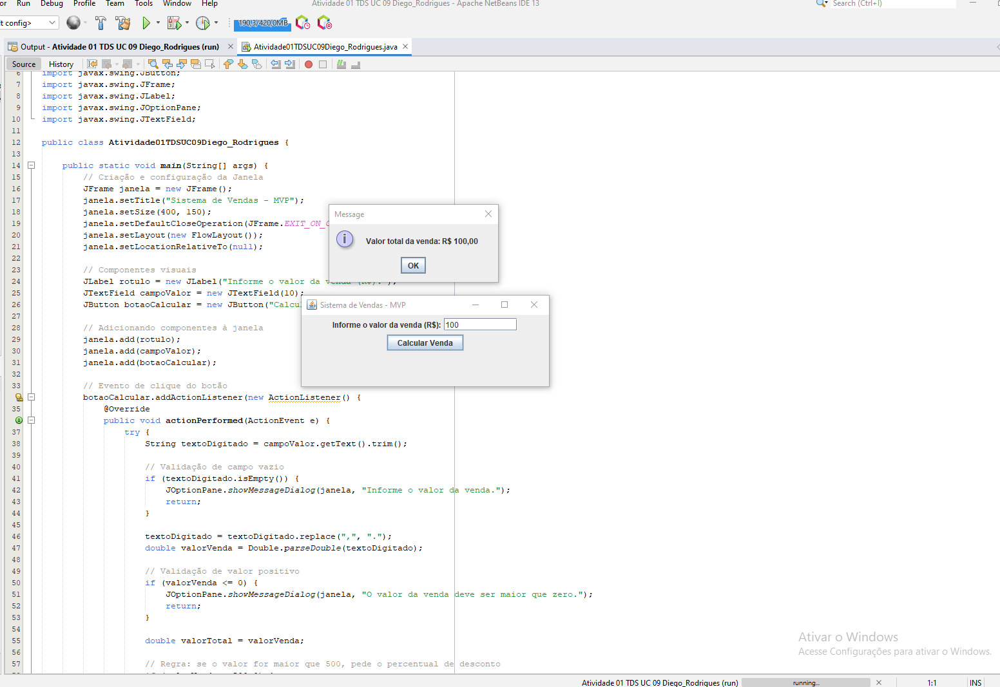
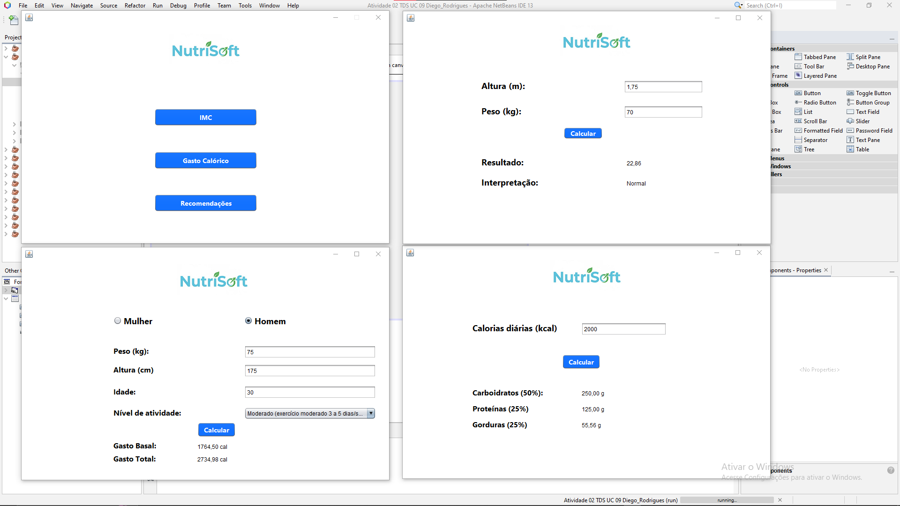

# 💻 Desenvolvimento de Interface Gráfica para Aplicações Desktop — UC09 (Senac EAD)

Bem-vindo ao repositório oficial da Unidade Curricular **Desenvolver e organizar interface gráfica para aplicações desktop** do curso Técnico em Desenvolvimento de Sistemas do Senac EAD. Este espaço documenta a conceção, desenvolvimento e implementação de aplicações desktop robustas em **Java**, utilizando o ambiente de desenvolvimento NetBeans, bibliotecas Swing, manipulação de coleções em memória, tratamento de exceções e persistência de dados em ficheiros.

---

## 🚀 Visão Geral do Módulo

O objetivo desta UC foi transitar da lógica de programação estruturada para a construção de interfaces gráficas de utilizador (*GUI*) funcionais, seguras e centradas na experiência do utilizador (*UX/UI*). Ao longo das quatro atividades práticas, foram abordados conceitos fundamentais de orientação a objetos, eventos, componentes visuais avançados (`JTable`, `JComboBox`, `JTextArea`), validações de formulários e integração com o sistema de ficheiros (CSV).

---

## 📂 Estrutura e Desenvolvimento das Atividades

### 🔍 Atividade 1 — Lógica Base e Caixas de Diálogo em Java
* **Foco:** Implementação de um MVP (Produto Viável Mínimo) em Java puramente via código (sem ferramentas visuais).
* **Entregáveis & Tecnologias:** 
  * Criação de janelas e gestão de eventos (*ActionListener*).
  * Utilização de caixas de diálogo (*JOptionPane*) para recolha de valores de vendas e aplicação condicional de percentuais de desconto para valores superiores a R$ 500.

### ⚖️ Atividade 2 — Aplicação Gráfica Modular (NutriSoft)
* **Foco:** Construção de interfaces gráficas utilizando a ferramenta visual (*Design*) do NetBeans.
* **Módulos Implementados:**
  * **Cálculo de IMC:** Validação de entradas (altura e peso), cálculo matemático e classificação dinâmica do estado nutricional (de magreza a obesidade grave.
  * **Cálculo de Gasto Calórico:** Fórmulas individualizadas por sexo (Homem/Mulher) e aplicação de multiplicadores de nível de atividade física através de listas suspensas (`JComboBox`).
  * **Recomendações Nutricionais:** Cálculo automatizado da distribuição diária de macronutrientes (carboidratos, proteínas e gorduras) expressos em gramas.

### 📅 Atividade 3 — Sistema de Agendamento e Gestão de Consultas
* **Foco:** Gestão de dados em memória e manipulação de componentes tabulares dinâmicos[cite: 20].
* **Entregáveis & Funcionalidades:**
  * Listagem em tempo real de pacientes numa tabela interativa (`JTable`).
  * Formulários dedicados ao cadastro e validação estrita de dados (CPF, telefone, datas).
  * Módulo de finalização de consultas com registo de histórico clínico, observações e receitas médicas.

### 🫀 Atividade 4 — Monitorização de Saúde e Persistência de Dados (CSV)
* **Foco:** Acessibilidade, usabilidade para o público idoso e persistência de dados em ficheiros externos.
* **Entregáveis & Tecnologias:**
  * Aplicação de princípios de acessibilidade (caracteres legíveis, *tooltips* descritivos e associação direta de rótulos `JLabel` aos campos).
  * Registo de parâmetros clínicos de pressão arterial (sistólica e diastólica), hora, data e indicadores de estresse.
  * **Persistência em Ficheiro (`medicoes.csv`):** Implementação de rutinas de leitura e escrita em disco para garantir que o histórico do paciente seja carregado e atualizado de forma persistente a cada execução do programa.

---

## 🛠️ Tecnologias, Ferramentas & Padrões

* **Linguagem:** Java (JDK).
* **IDE & Interface:** NetBeans IDE, Java Swing (*JFrame*, *JPanel*, *JTable*, *JOptionPane*).
* **Gestão de Dados:** Coleções Java (*Collections Framework*), Leitura/Escrita de Ficheiros (CSV).
* **Controlo de Versão:** Git & GitHub.

---

### 🔍 Atividade 1 — Lógica Base e Caixas de Diálogo em Java
* **Foco:** Implementação de um MVP em Java puramente via código (sem recurso a editores visuais), garantindo validações robustas e tratamento de exceções.
* **Pré-visualização da Aplicação:**

---

---

### 🔍 Atividade 2 — Desenvolvimento de Interface Gráfica e Padronização Visual (NutriSoft)

* **Foco:** Criação de um sistema desktop em Java Swing com múltiplas janelas (`TelaPrincipal`, `Telaimc`, `TelaGastoCalorico`, `TelaRecomendacoes`), padronização de dimensões fixas (`800x505`), fundos limpos em branco e identidade visual integrada com logo própria.
* **Pré-visualização da Aplicação:**

